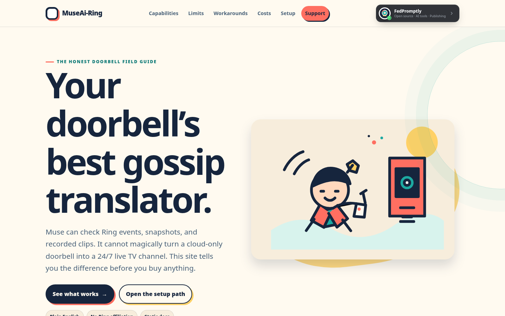
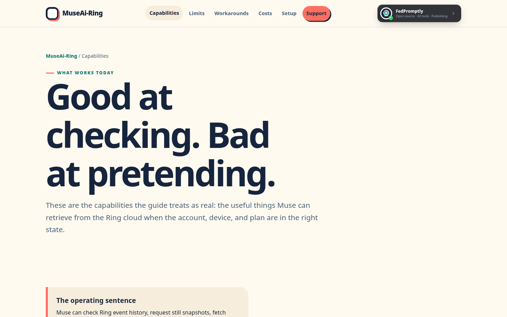
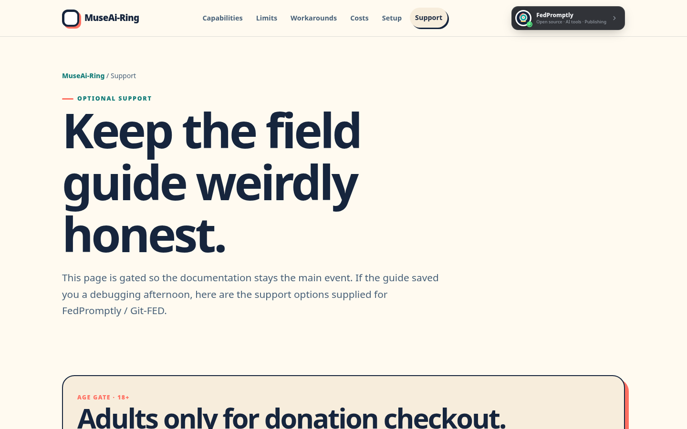
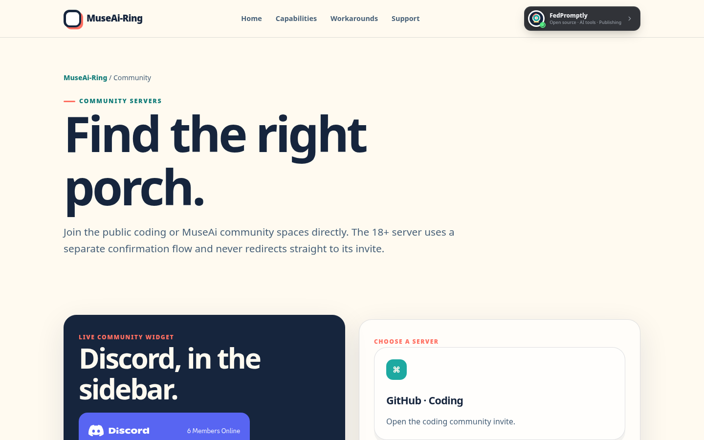

# MuseAi-Ring

> A plain-English, multi-page field guide to what Muse can check through Ring doorbell cameras—and where the limits are.


## Why this exists

The difficult part of connecting an AI assistant to a doorbell is not making a page that says “smart home.” It is separating the useful checks from the promises the camera platform cannot actually keep.

People want to know what happened while they were away: whether someone rang, what the latest snapshot shows, and whether a recorded clip exists. They also need to know when a battery camera may return a cached image, when a recording plan is required, why unofficial APIs can break, and why direct live view is a different problem.

MuseAi-Ring makes that trade-off readable. It is intentionally a documentation template, not an official Ring product or a fake live-camera demo.

## See it work

The fastest real demo is the local static preview. There is no published live demo URL in this repository, so this README does not invent one.

### 30-second tour

This animated tour is made from screenshots of the actual running site—not a mockup:


### Quick start

From the repository root:

```bash
npm start
```

Then open [http://localhost:3000](http://localhost:3000).

The real entry point is [`index.html`](index.html). The most useful first pages are:

- [`what-muse-can-do.html`](what-muse-can-do.html) — events, snapshots, recorded clips, scheduled checks, and dependencies.
- [`what-muse-cant-do-yet.html`](what-muse-cant-do-yet.html) — live-view limits, unofficial API risk, battery throttling, and cloud dependency.
- [`workarounds.html`](workarounds.html) — seven practical workarounds with latency, reliability, and maintenance trade-offs.
- [`setup-checklist.html`](setup-checklist.html) — the buy → install → attach → maintain path.
- [`support.html`](support.html) — age-gated donation and sponsorship options.
- [`community.html`](community.html) — public Discord communities and the safe 18+ access-request flow.

## Screenshots

These are real screenshots captured from the local application.

### Homepage



### Capability guide



### Support gate



### Community page



## The visual language

The site uses a small set of local comic illustrations so the ZIP remains portable and does not depend on a stock-photo CDN.


The browser icon is a symbol-based SVG at [`assets/favicon.svg`](assets/favicon.svg), not a lettermark.

## What is included

- Direct HTML pages for capabilities, limits, future changes, workarounds, prices, buying, installation, attachment, privacy, setup, support, community, private communities, and 404 handling.
- Shared responsive CSS with animated entrances, hover effects, marquee treatment, and `prefers-reduced-motion` support.
- A compact animated FedPromptly invite control in the shared header, with a community modal and contact links; it is an invite card, not a login/authentication system.
- An 18+ self-attestation before donation widgets load.
- A supplied GitHub Sponsors card plus PayPal, Ko-fi, Buy Me a Coffee, NOWPayments, and Stripe options on the gated support page.
- A safe NSFW Discord flow that goes to [`nsfw-request.html`](nsfw-request.html) and asks the visitor to email `museai@fedpromptly.com`; it does not expose the invite directly.
- A private-communities page that keeps the Matrix URL out of the public footer and reveals it only after age and country self-attestation.
- Static-hosting helpers: `.nojekyll`, `_redirects`, `_headers`, [`wrangler.toml`](wrangler.toml), and [`manus-routes.json`](manus-routes.json).
- [`server.js`](server.js), a dependency-free local preview server.

## Quick checks

There is no package build step and no test runner configured. These are the checks used for the static bundle:

```bash
node --check server.js
node --check script.js
python3 -m json.tool manus-routes.json >/dev/null
```

The HTML pages use relative internal links, and the archive validation checks that every local navigation target exists as an `.html` file.

## Deploy it

### GitHub Pages

Upload the repository, then enable GitHub Pages from the branch and repository-root folder. The included `.nojekyll` file and relative HTML links support project-subpath hosting.

### Cloudflare Pages

Create a static Pages project using the repository root as the build output. No framework or build command is required for the committed static files. [`wrangler.toml`](wrangler.toml) is included for Pages-aware tooling.

No hosted deployment is claimed here; the reliable demo is the local preview until you publish the folder yourself.

## Scope and honesty notes

MuseAi-Ring is a documentation template built from the supplied public-source brief. It is not affiliated with Ring or Amazon, does not contain a Ring connector, and does not provide live camera access. Prices, plan names, platform behavior, and third-party service terms can change; verify current details before buying or deploying.
